# Teste Caixa Cinza com Supabase e Postman

**Aluno:** André
**Disciplina:** UX/UI e Testes de Software
**Atividade:** Atividade Individual — Teste Caixa Cinza com Supabase e Postman

---

# Introdução

Este repositório documenta a execução de testes de caixa cinza na API de autenticação do Supabase, utilizando o Postman Desktop. O teste é de caixa cinza porque o testador conhece parte da estrutura do sistema (endpoint, headers, formato do body JSON e códigos de resposta HTTP), mas não tem acesso ao código-fonte interno do serviço.

Não foi implementada interface gráfica. Toda a validação foi feita diretamente sobre as requisições HTTP.

Estrutura do repositório:

```
/README.md
/postman/    -> collection exportada do Postman
/prints/     -> evidências (prints) numeradas
/planilha/   -> planilha de registro dos testes
```

# Objetivo da Atividade

Aplicar testes de caixa cinza em uma API de autenticação, cobrindo:

- configuração de um ambiente de autenticação no Supabase;
- criação de usuário de teste;
- configuração do Postman (workspace, environment e variáveis);
- criação e execução de requisições HTTP de login;
- validação de status HTTP, respostas JSON, mensagens de erro e access token;
- registro e documentação técnica de todos os testes.

# Configuração do Supabase

**Como o projeto foi criado:** foi criada uma conta no Supabase e, em seguida, um novo projeto chamado `teste-caixa-cinza-andre`, na organização `andreborgezz's Org` (plano Free). O projeto ficou com o status *Healthy* após o provisionamento.

**Tipo de autenticação:** autenticação por **e-mail e senha** (provider *Email*), habilitado em *Authentication > Sign In / Providers*. A opção *Confirm email* foi desligada para permitir o login do usuário de teste sem a etapa de confirmação por e-mail.

**Como o usuário foi criado:** em *Authentication > Users > Add user > Create new user*, foi cadastrado o usuário `andre.teste@email.com` com senha definida pelo aluno e a opção *Auto Confirm User* marcada.

**Credenciais obtidas (Project Settings > API Keys):**

| Item | Valor |
|---|---|
| Project URL | `https://vriogypverpgtgbhwxiy.supabase.co` |
| API Key (publishable) | `sb_publishable_XXXXX` |

Apenas a chave pública (*publishable*) foi utilizada. A chave privada (*secret*) não foi usada nos testes e não consta neste repositório.

**Objetivo da configuração:** ter um serviço de autenticação real e funcional, com um usuário válido conhecido, para servir de alvo dos testes de login.

**Evidências:**

Projeto criado e painel do Supabase (identificação do aluno no nome do projeto e na organização):

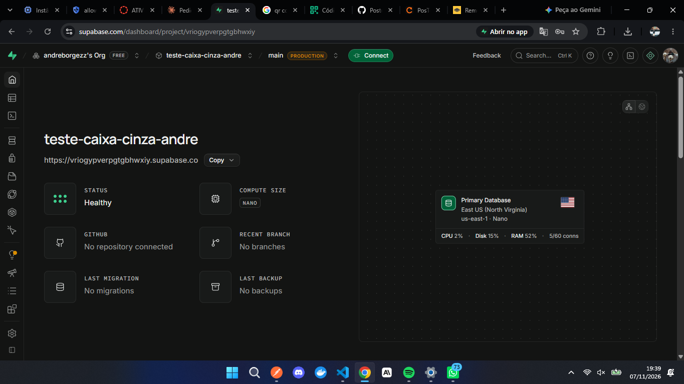

Autenticação por e-mail habilitada:

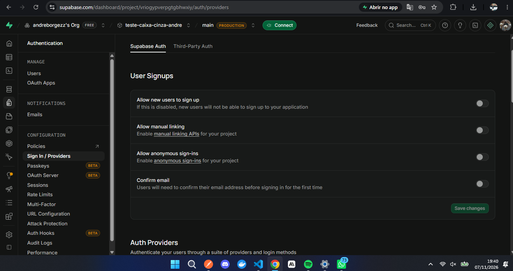

Usuário criado:

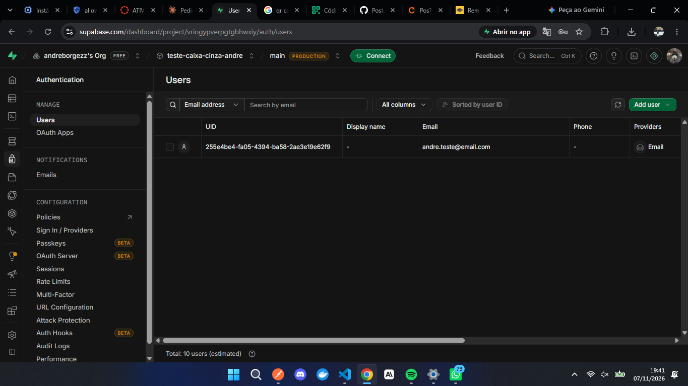

Credenciais da API:

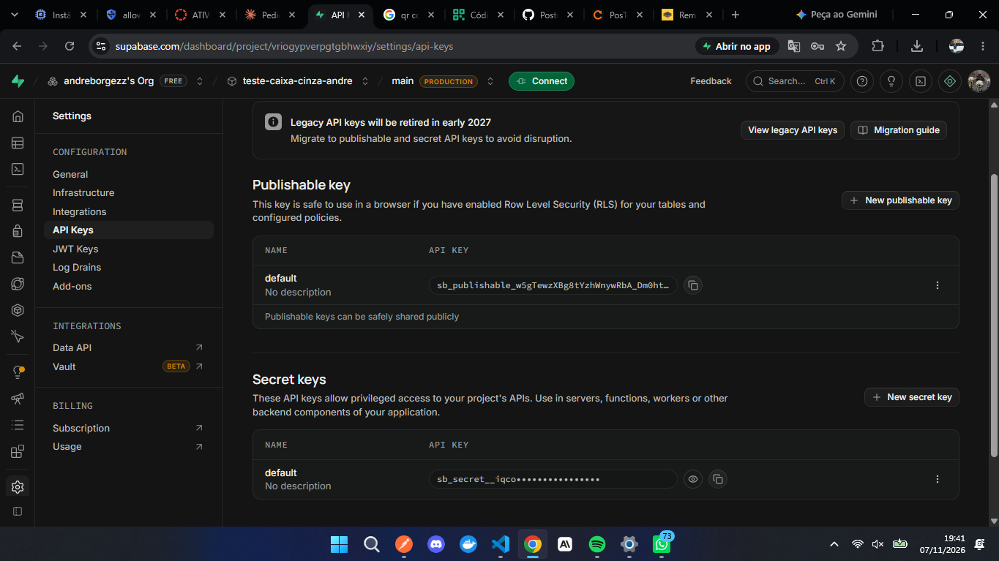

# Configuração do Postman

**Workspace:** foi criado o workspace `Teste Caixa Cinza - Andre` (tipo Blank workspace, visibilidade pessoal), que concentra todos os artefatos da atividade.

**Environment:** foi criado o environment `Supabase Auth - Andre` e selecionado como ativo. Ele guarda as variáveis usadas por todas as requisições, evitando repetir URL e credenciais em cada uma.

| Variável | Descrição |
|---|---|
| `base_url` | URL da API do Supabase (Project URL) |
| `api_key` | API Key pública do projeto |
| `email` | E-mail do usuário criado para testes |
| `password` | Senha do usuário criado para testes |

**Como o Postman é utilizado nos testes:** as requisições ficam organizadas na collection `Testes Auth Supabase` e usam as variáveis do environment (`{{base_url}}`, `{{api_key}}`, `{{email}}`, `{{password}}`). Cada cenário de teste é uma requisição da collection, o que permite reexecutar e comparar os resultados com facilidade.

**Evidências:**

Workspace criado:

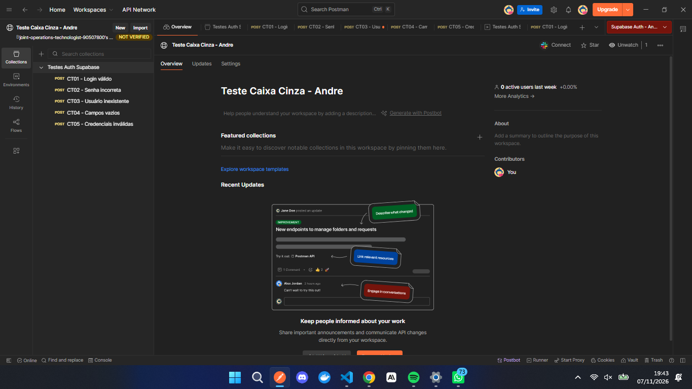

Environment e variáveis configuradas:

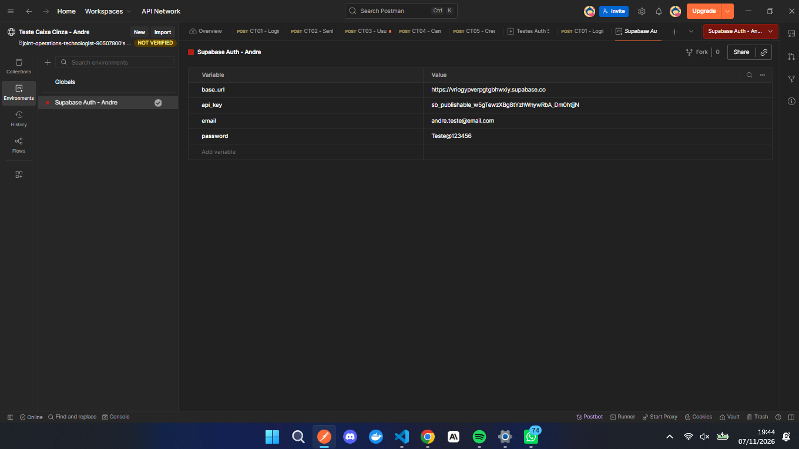

Organização do Postman (collection e environment ativo):

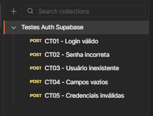

# Configuração das Requisições

**Endpoint utilizado:**

```
{{base_url}}/auth/v1/token?grant_type=password
```

**Método HTTP:** `POST`

**Finalidade da requisição:** autenticar um usuário por e-mail e senha (fluxo *password grant*). Em caso de sucesso, a API retorna o `access_token` (JWT), o `refresh_token` e os dados do usuário. Em caso de falha, retorna um JSON com o código e a mensagem do erro.

**Headers utilizados:**

| Header | Valor |
|---|---|
| `apikey` | `XXXXX` (valor de `{{api_key}}`) |
| `Authorization` | `Bearer XXXXX` (valor de `{{api_key}}`) |
| `Content-Type` | `application/json` |

**Body JSON utilizado:**

```json
{
  "email": "andre.teste@email.com",
  "password": "********"
}
```

No Postman, o body usa as variáveis do environment: `"email": "{{email}}"` e `"password": "{{password}}"`.

**Evidências:**

Endpoint e método configurados:

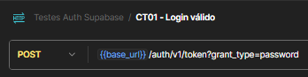

Headers:

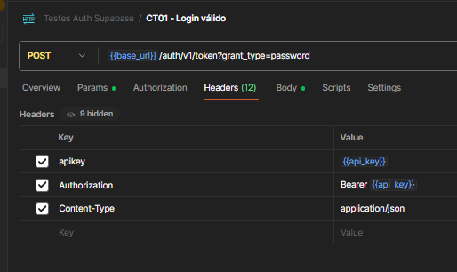

Body JSON:

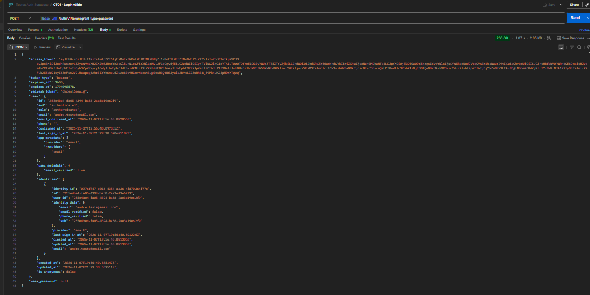

# Execução dos Testes

Foram executados os 5 cenários obrigatórios, todos sobre o mesmo endpoint. Cada cenário é uma requisição da collection (`CT01` a `CT05`), criada a partir da duplicação da `CT01`, alterando apenas o body.

| Cenário | Entrada Utilizada | Resultado Esperado | Resultado Obtido | Status |
|---|---|---|---|---|
| CT01 - Login válido | E-mail e senha corretos do usuário criado | Status 200 + access token | 200 OK, JSON com `access_token`, `refresh_token` e dados do usuário | OK |
| CT02 - Senha incorreta | E-mail correto + senha `SenhaErrada999` | Erro de autenticação | 400 Bad Request, `error_code: invalid_credentials`, `msg: Invalid login credentials` | OK |
| CT03 - Usuário inexistente | E-mail `naoexiste@email.com` + senha válida | Acesso negado | 400 Bad Request, `error_code: invalid_credentials`, `msg: Invalid login credentials` | OK |
| CT04 - Campos vazios | `email: ""` e `password: ""` | Erro de validação | 400 Bad Request, `error_code: validation_failed`, `msg: missing email or phone` | OK |
| CT05 - Credenciais inválidas | E-mail `emailinvalido` + senha `123` | Mensagem de erro | 400 Bad Request, `error_code: invalid_credentials`, `msg: Invalid login credentials` | OK |

**Validações realizadas em cada teste:** status HTTP, estrutura do JSON de resposta, mensagem de erro e presença (ou ausência) do access token.

**Erro encontrado durante a execução:** na primeira rodada dos cenários CT02 a CT05, todas as requisições retornaram `401 Unauthorized` com a mensagem `No API key found in request` e a dica `No apikey request header or url param was found`. A causa foi que, ao duplicar a requisição CT01, os headers (`apikey`, `Authorization` e `Content-Type`) não foram copiados (a aba Headers mostrava 9 itens, contra 12 na CT01). Como a API key não foi enviada, o Supabase rejeitou as requisições antes de avaliar e-mail e senha. Os headers foram adicionados manualmente às quatro requisições e os testes foram reexecutados, gerando os resultados válidos da tabela acima.

**Evidências:**

CT01 - Login válido (200 OK e access token):

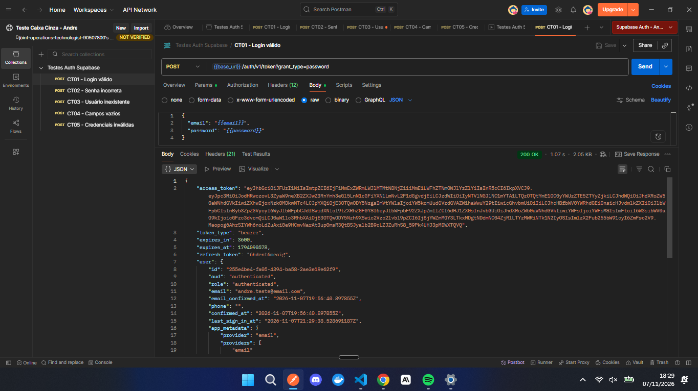

CT02 - Senha incorreta:

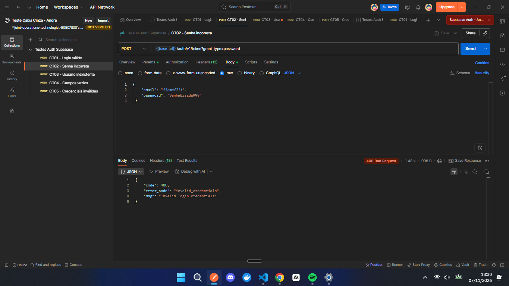

CT03 - Usuário inexistente:

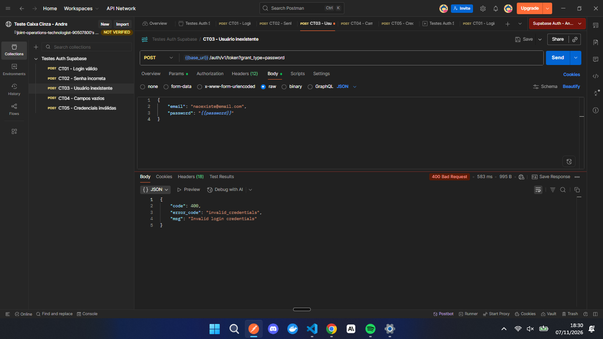

CT04 - Campos vazios:

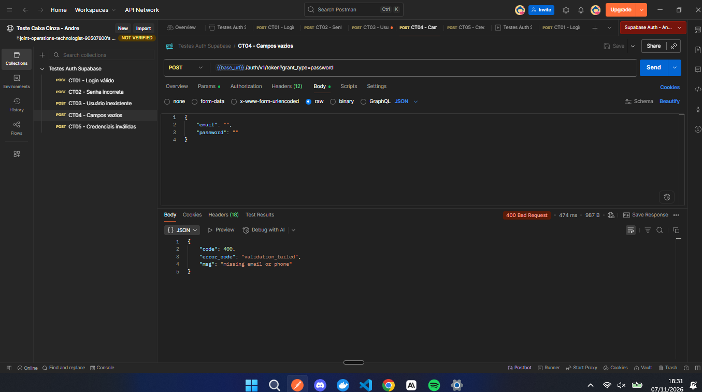

CT05 - Credenciais inválidas:

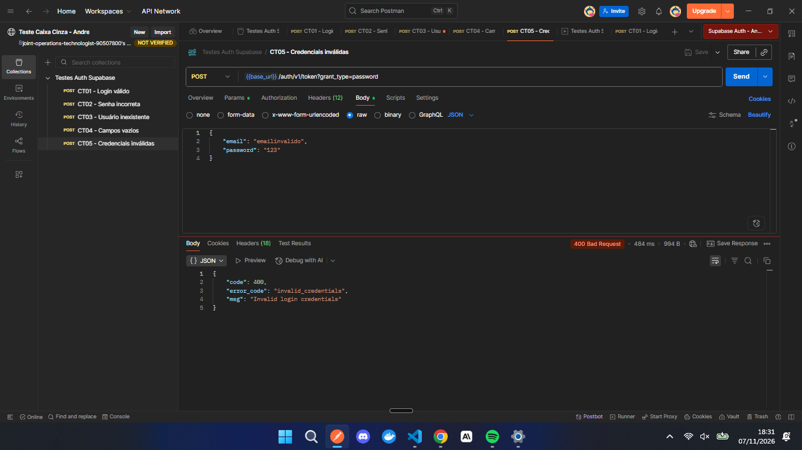

Erro de API key ausente (primeira rodada, antes da correção dos headers):

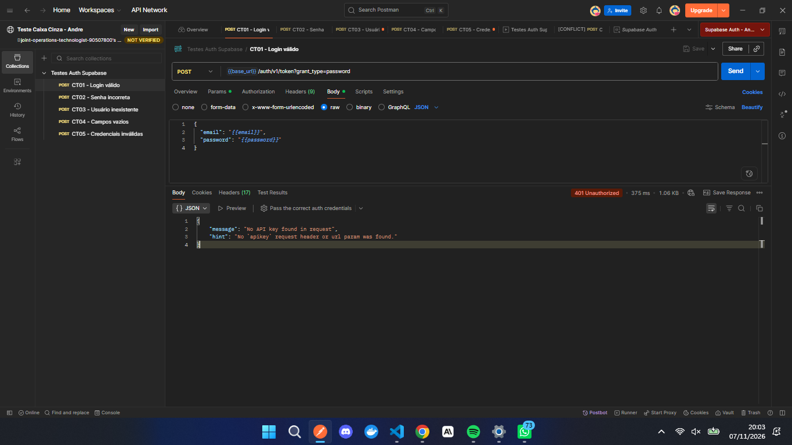

# Registro dos Testes

**Como os testes foram registrados:** cada execução foi registrada em uma planilha (`planilha/testes-caixa-cinza.xlsx`) com os campos ID do teste, Cenário, Entrada, Resultado esperado, Resultado obtido, Status e Observações. Além dos 5 cenários obrigatórios, foi registrado o caso da requisição sem API key (CT06), identificado durante a execução.

**Importância da documentação dos testes:** o registro permite repetir os testes nas mesmas condições, comparar resultados entre execuções, comprovar o que foi validado e identificar regressões quando o sistema mudar. Sem registro, o teste não é rastreável nem auditável.

**Falhas identificadas:**

- Requisições duplicadas no Postman perderam os headers, o que gerou `401 Unauthorized` até a correção (detalhado em *Execução dos Testes*).
- No CT05, um e-mail malformado (`emailinvalido`) não gerou erro de validação de formato. A API retornou o mesmo erro genérico `invalid_credentials` dos demais cenários de credencial incorreta.

**Evidência:**

Planilha preenchida:

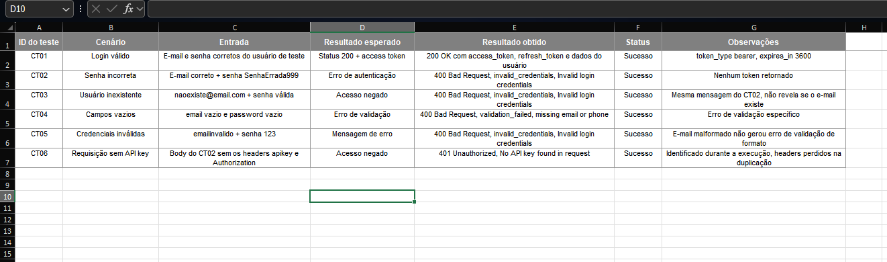

# Resultados Obtidos

| Item | Resultado |
|---|---|
| Cenários obrigatórios executados | 5 de 5 |
| Cenários com resultado conforme o esperado | 5 de 5 |
| Casos adicionais registrados | 1 (CT06 - requisição sem API key) |
| Status HTTP de sucesso | 200 (CT01) |
| Status HTTP de erro | 400 (CT02 a CT05) e 401 (CT06) |
| Access token retornado | Sim, apenas no CT01 |

Resumo do comportamento observado:

- O login com credenciais corretas retornou `200 OK`, com `access_token` (JWT, `token_type: bearer`, `expires_in: 3600`), `refresh_token` e os dados do usuário.
- Senha incorreta, usuário inexistente e e-mail malformado retornaram o mesmo erro (`400`, `invalid_credentials`, `Invalid login credentials`). Isso é coerente com boas práticas de segurança, pois não revela se o e-mail existe na base.
- Campos vazios retornaram `400` com `validation_failed` e a mensagem `missing email or phone`.
- Requisição sem API key retornou `401` com `No API key found in request`.

Collection exportada do Postman: pasta [`/postman`](postman/).

# Conclusão

**Os testes foram executados corretamente?** Sim. Os 5 cenários obrigatórios foram executados pelo próprio aluno, com evidências reais, e todos retornaram o resultado esperado. Na primeira rodada, quatro deles precisaram ser refeitos por causa de um erro de configuração (headers ausentes), já corrigido e documentado.

**A autenticação funcionou?** Sim. O usuário válido obteve `access_token` com status 200, e todas as tentativas inválidas foram recusadas com status e mensagens adequados.

**Dificuldades encontradas:** a principal foi a perda dos headers ao duplicar requisições no Postman, que mascarou o comportamento real da API até ser identificada. Também foi preciso ter cuidado para não expor a chave privada (*secret*) do Supabase e usar apenas a chave pública.

**Falhas identificadas:** a falha de configuração dos headers (corrigida) e o fato de o e-mail malformado não receber uma mensagem de validação específica, retornando o erro genérico de credenciais.

**Melhorias que poderiam ser implementadas:**

- criar um header comum no nível da collection (ou usar a aba Authorization da collection), para que todas as requisições herdem `apikey` e `Content-Type`;
- adicionar scripts de teste no Postman (aba Tests) para validar automaticamente status e campos do JSON;
- incluir cenários adicionais: e-mail com letras maiúsculas, senha muito longa, body sem o campo `password`, método HTTP incorreto, token expirado e múltiplas tentativas seguidas (limite de requisições);
- executar a collection pelo Collection Runner para gerar um relatório único.

**Importância dos testes caixa cinza em APIs:** como o testador conhece o contrato da API (endpoint, headers, body e códigos esperados), consegue montar cenários mais direcionados do que em um teste caixa preta, sem depender do código-fonte, como no caixa branca. Isso permite validar regras de autenticação, mensagens de erro e comportamento de segurança de forma rápida, barata e repetível, antes mesmo de existir uma interface gráfica.
